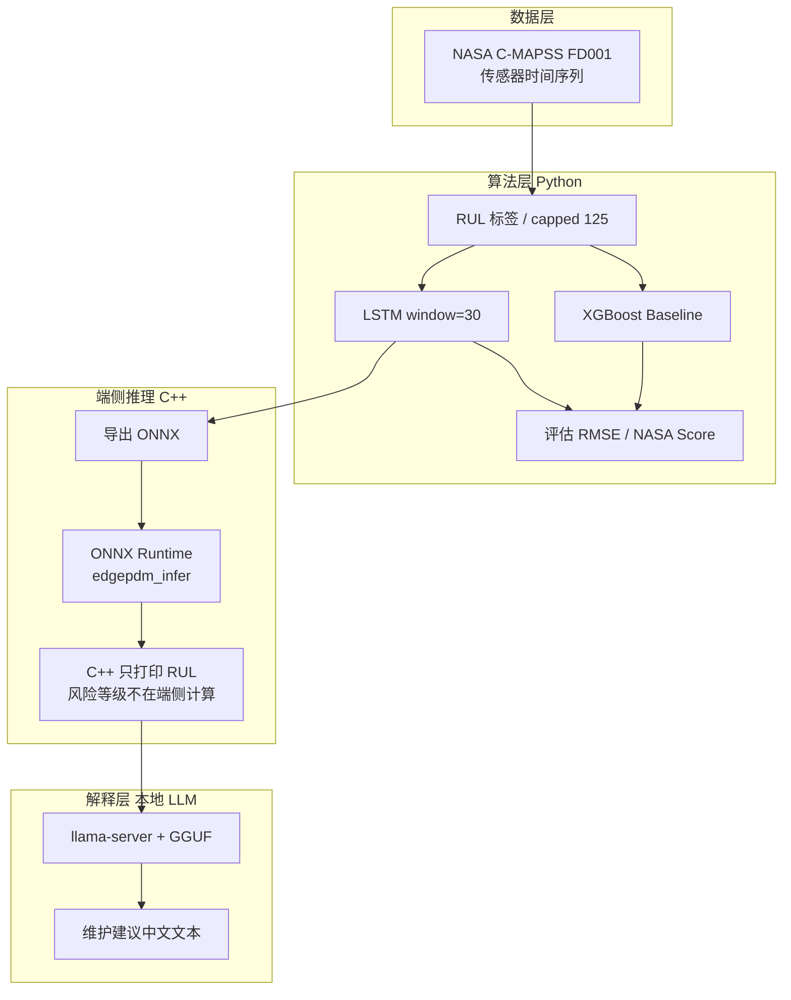

# EdgePdM-Agent 架构图

## 模块边界

| 模块 | 负责 | 不负责 |
|------|------|--------|
| LSTM/XGBoost | 预测 RUL | 写维修话术 |
| C++ ORT | 对预缩放窗口做低延迟推理，打印 RUL | 训练、滚动特征、标准化、风险分级、异常传感器 |
| llama.cpp | 解释 JSON | 预测 RUL / 查手册 RAG |
